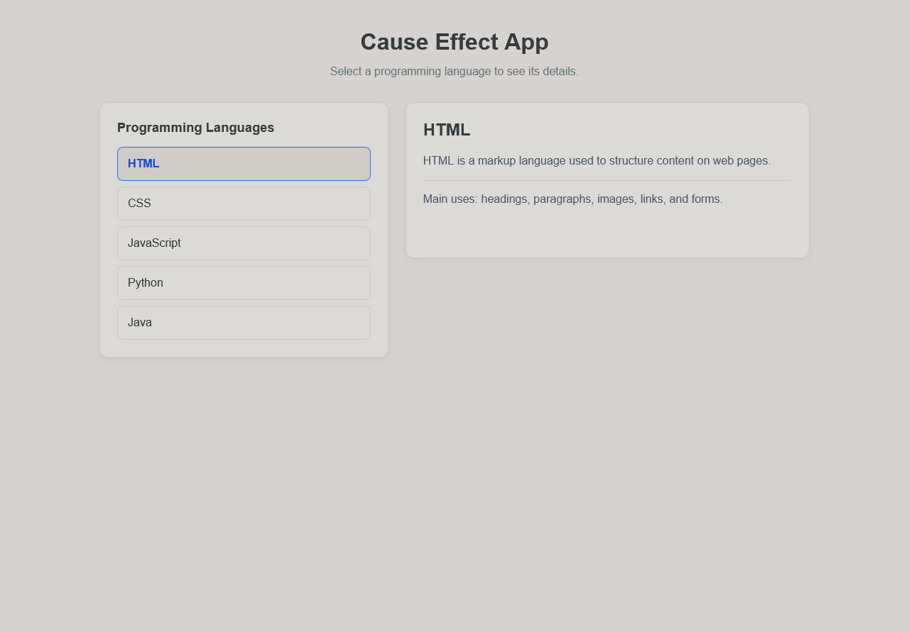

# 🔄 Cause Effect App

A simple and interactive web application that displays detailed information when a user clicks an item in a list. Built with HTML, CSS, and JavaScript to practice DOM manipulation, event handling, and dynamic content rendering.

## 📌 About the Project

The **Cause Effect App** is a web development project where selecting an item from a list updates a details panel with information related to that item.

This version uses programming languages as examples. When a user selects a language, the application displays its description and main use cases.

The project was created to strengthen fundamental JavaScript skills and understand how user interactions can dynamically update a web interface.

## ✨ Features

- [x] Display a list of programming languages.
- [x] Show item details when clicked.
- [x] Highlight the currently selected item.
- [x] Update content dynamically without reloading the page.
- [x] Support keyboard interaction using Enter and Space.
- [x] Responsive layout for different screen sizes.
- [x] Simple and clean user interface.

## 🛠️ Technologies Used

- **HTML5:** Structures the application and its content.
- **CSS3:** Provides styling, layout, hover effects, and responsive design.
- **JavaScript:** Handles user interactions, DOM manipulation, and dynamic content updates.
- **Git and GitHub:** Version control and source code hosting.

## 📂 Project Structure

```text
Cause-Effect-App/
│
├── index.html
├── style.css
├── script.js
└── README.md
```

## 🚀 Getting Started

### Prerequisites

You only need a modern web browser. Visual Studio Code and the Live Server extension are optional.

### 1. Clone the Repository

```bash
git clone https://github.com/YOUR-USERNAME/Cause-Effect-App.git
```

### 2. Navigate to the Project Directory

```bash
cd Cause-Effect-App
```

### 3. Run the Application

Open the `index.html` file directly in your browser or use the Live Server extension in Visual Studio Code.

No additional dependencies or build tools are required.

## ⚙️ How It Works

The application uses a JavaScript array to store information about each programming language.

When the page loads, JavaScript dynamically creates a list of items. When the user selects an item, an event listener triggers a function that updates the details panel and highlights the selected language.

The main JavaScript concepts used include:

- **Arrays and objects:** Store the information displayed in the application.
- **`forEach()`:** Iterates over the data to create list items.
- **`createElement()`:** Creates HTML elements dynamically.
- **`addEventListener()`:** Detects mouse clicks and keyboard interactions.
- **`textContent`:** Updates the displayed text.
- **`classList`:** Manages the visual state of the selected item.
- **DOM manipulation:** Connects the JavaScript logic to the HTML interface.

## 🎯 Learning Objectives

This project helps develop practical skills in:

- JavaScript fundamentals.
- DOM manipulation.
- Event handling.
- Arrays and objects.
- Dynamic content rendering.
- CSS layouts and responsive design.
- Basic accessibility and keyboard navigation.
- Code organization and project documentation.

## 🔮 Future Improvements

Possible improvements for future versions include:

- [ ] Add icons for each programming language.
- [ ] Add more programming languages and technologies.
- [ ] Implement search functionality.
- [ ] Add light and dark themes.
- [ ] Create animations when switching between items.
- [ ] Improve accessibility.
- [ ] Add automated tests.

## 📸 Screenshots

Add a screenshot of the application to showcase its interface.

Example:

```markdown

```

Make sure the screenshot exists at the specified path in your repository.

## 👨‍💻 Author

**Lucas Neves**

This project was developed for educational purposes and as part of my software development portfolio.

## 📄 License

This project can be distributed under the MIT License. To use this license, add a `LICENSE` file to the repository containing the full license text.

---

⭐ If you found this project useful, consider giving the repository a star!

**Built with HTML, CSS, and JavaScript. 💻**
